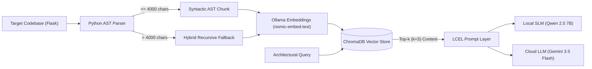

# CodeBase-RAG-Analyzer: AST-Aware Architectural Querying System

[](https://www.python.org/)
[](https://www.langchain.com/)
[](https://www.trychroma.com/)
[](https://ollama.com/)
[](https://streamlit.io/)
[](./docs/Q1039255_Barbaros_Yesilova_Dissertation.pdf)
[](./LICENSE)

> **BSc Computer Science and Digitisation Dissertation Project**  
> *Automatic Code Base Analysis and Architectural Querying System Using Retrieval-Augmented Generation (RAG) and Large Language Models*  
> **Author:** Barbaros Yeşilova  
> **Institution:** University for the Creative Arts (UCA) & Berlin School of Business and Innovation (BSBI)  
> 📄 **[Read the Full Dissertation (PDF)](./docs/Q1039255_Barbaros_Yesilova_Dissertation.pdf)**

## 📌 Overview & Problem Statement
While Large Language Models (LLMs) excel at code generation and explanation, deploying them on enterprise-scale codebases faces two major hurdles:
1. **Context Fragmentation in Traditional RAG:** Standard character/token-based text splitters break syntactic boundaries (classes, functions), diluting semantic context and causing hallucinations.
2. **The Privacy vs. Performance Dilemma:** Sending proprietary source code to third-party cloud APIs introduces severe intellectual property and data leakage risks.

**CodeBase-RAG-Analyzer** implements a **privacy-first, model-agnostic Retrieval-Augmented Generation (RAG) architecture** that parses source code into an **Abstract Syntax Tree (AST)**. Instead of treating code as flat text, it indexes structural entities (`FunctionDef`, `ClassDef`, `AsyncFunctionDef`) with an adaptive recursive fallback mechanism for monolithic blocks (>4,000 characters).

---

## 🏗️ System Architecture
* **AST Ingestion & Hybrid Chunking:** Uses Python's native `ast` module to isolate complete syntactic blocks. Monolithic nodes exceeding 4,000 characters gracefully degrade via `RecursiveCharacterTextSplitter` (`chunk_size=4000`, `chunk_overlap=200`) while retaining hierarchical metadata (`{node.name}_part{i+1}`).
* **Vectorization & Storage:** Encodes structural chunks locally using `nomic-embed-text` via Ollama and persists them into **ChromaDB**.
* **Model-Agnostic Generation Layer:** Built on **LangChain (LCEL)** and **Streamlit**, allowing seamless runtime switching between:
  * 🔒 **On-Premises (Air-Gapped):** `Qwen 2.5 (7B)` via Ollama for 100% data sovereignty.
  * ☁️ **Cloud API:** `Google Gemini 3.5 Flash` for low-latency, high-capacity pedagogical design pattern mapping.



---

## 📊 Experimental Results & Benchmarks
The system was benchmarked against a naive baseline (`RecursiveCharacterTextSplitter` with 1,000-character chunks and 200-character overlap) on the open-source **Flask** repository across a curated 15-question architectural ground-truth dataset.

### 1. Retrieval Performance ($k=3$)
| Evaluation Metric | Baseline (Naive Recursive) | AST-Aware (Proposed) |
| :--- | :---: | :---: |
| **Hit Rate (@3)** | 86.67% | **86.67%** |
| **Mean Reciprocal Rank (MRR)** | 0.678 | **0.789** |
| **Query Execution Time** | 0.99s | **0.31s** |

*Key Finding:* While both methods achieved identical Hit Rates at $k=3$, the **AST-aware parser improved MRR by +16.3% (0.789 vs. 0.678)**, consistently ranking the exact target module at **Rank 1** by preserving syntactic boundaries.

### 2. Downstream Generation & Local RAGAS Evaluation
Evaluated using the **RAGAS** framework configured with a privacy-preserving local LLM-as-a-judge (`Qwen 2.5 7B` via `ChatOllama`) on an Apple Silicon (M4 Pro) host:

| Evaluation Metric | Qwen 2.5 7B (Local / Ollama) | Gemini 3.5 Flash (Cloud API) |
| :--- | :---: | :---: |
| **Mean Inference Latency** | 27.35s | **20.02s** |
| **Answer Relevance** | **79.6%** | 73.4% |
| **Faithfulness (Grounding)** | **81.3%** | 55.1% |

*Key Finding:* Although Gemini 3.5 Flash offered faster inference and rich pedagogical formatting, it relied heavily on pre-trained assumptions outside the retrieved context (55.1% Faithfulness). Conversely, **local Qwen 2.5 (7B) achieved 81.3% Faithfulness**, proving that on-premises SLMs paired with AST-RAG strictly adhere to retrieved codebase evidence without leaking proprietary data.

---

## 🚀 Getting Started

### Prerequisites
1. **Python 3.11+**
2. **[Ollama](https://ollama.com/)** installed and running locally (`ollama serve`).
3. Pull the required local embedding and inference models via Ollama:
   ```bash
   ollama pull nomic-embed-text
   ollama pull qwen2.5:7b
   ```

### Installation & Setup
1. **Clone the repository:**
   ```bash
   git clone https://github.com/Barbarouge/CodeBase-RAG-Analyzer.git
   cd CodeBase-RAG-Analyzer
   ```

2. **Create and activate a virtual environment:**
   ```bash
   python3 -m venv .venv
   source .venv/bin/activate  # On Windows: .venv\Scripts\activate
   ```

3. **Install dependencies:**
   ```bash
   pip install -r requirements.txt
   ```

4. **Clone the target benchmark repository (Flask):**
   ```bash
   git clone https://github.com/pallets/flask.git ./flask
   ```

5. **Configure environment variables (Optional for Cloud Inference):**
   ```bash
   cp .env.example .env
   ```
   Edit `.env` and provide your `GEMINI_API_KEY` if you plan to evaluate or query the cloud model. Local inference via Ollama requires no API keys.

---

## 💻 Usage

### 1. Interactive Streamlit Application
Launch the web interface to build the AST vector database and interactively query the codebase:
```bash
streamlit run app.py
```
1. Open the **⚙️ Knowledge Base Management** expander and click **🔨 Parse & Save (Build DB)** to parse `./flask/src/flask` into `./chroma_db`.
2. Choose between **Local LLM** (`Qwen 2.5 7B`) or **Gemini 3.5 Flash**.
3. Submit architectural queries and inspect the generated explanation alongside the retrieved AST blocks and inference latency.

### 2. Reproducing Dissertation Benchmarks
After initializing the AST vector database (`./chroma_db`) via the Streamlit interface, you can reproduce all experimental tables from the dissertation:

1. **Build the Naive Baseline Vector Database (`./chroma_db_baseline`):**
   ```bash
   python scripts/build_baseline_db.py
   ```

2. **Run Retrieval Evaluation (Hit Rate @3 & MRR):**
   ```bash
   python scripts/evaluate_retrieval.py
   ```

3. **Run Generation & Local RAGAS Evaluation (Latency, Answer Relevance & Faithfulness):**
   ```bash
   python scripts/evaluate_generation.py
   ```

---

## 📂 Repository Structure
```text
CodeBase-RAG-Analyzer/
├── app.py                          # Main Streamlit UI, AST parser & LCEL RAG pipeline
├── docs/
│   └── Q1039255_Barbaros_Yesilova_Dissertation.pdf  # Full BSc Dissertation (PDF)
├── scripts/
│   ├── build_baseline_db.py        # Builds naive recursive chunking baseline DB
│   ├── evaluate_retrieval.py       # Evaluates Hit Rate (@3) and MRR across 15 queries
│   └── evaluate_generation.py      # Evaluates Qwen 2.5 vs. Gemini via local RAGAS judge
├── requirements.txt                # Python package dependencies
├── .env.example                    # Environment variable template
├── .gitignore                      # Ignored local artifacts, venv, and vector stores
├── CITATION.cff                    # Academic citation metadata
├── LICENSE                         # MIT License
└── README.md                       # Project documentation
```

---

## 📖 Citation
If you reference this work or codebase in your research, please cite:

```bibtex
@thesis{yesilova2026codebaserag,
  author       = {Ye{\c{s}}ilova, Barbaros},
  title        = {Automatic Code Base Analysis and Architectural Querying System Using Retrieval-Augmented Generation (RAG) and Large Language Models},
  school       = {University for the Creative Arts (UCA) and Berlin School of Business and Innovation (BSBI)},
  type         = {BSc Dissertation},
  year         = {2026},
  url          = {https://github.com/Barbarouge/CodeBase-RAG-Analyzer}
}
```

---

## 📄 License
This project is licensed under the [MIT License](./LICENSE).
